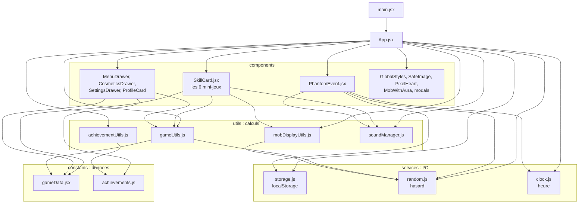

# Registre de dette technique

## 1. Carte du code

### Les fichiers principaux (au départ, le 16/11)

| Fichier | Lignes | Rôle |
|---|---|---|
| `src/main.jsx` | 9 | Point d'entrée, lance `App` |
| `src/App.jsx` | 1492 | Presque tout : état du jeu, sauvegarde, combats, micro, menus |
| `src/components/skills/SkillCard.jsx` | 778 | Les 6 mini-jeux |
| `src/components/ui/GlobalStyles.jsx` | 1302 | Tout le CSS dans un seul composant |
| `src/components/PhantomEvent.jsx` | 150 | Événement aléatoire (Phantom) |
| `src/components/drawers/` | | Menus : principal, cosmétiques, paramètres |
| `src/components/modals/` | | Popups : reset, bug report (vide pour l'instant) |
| `src/constants/gameData.jsx` | 416 | Données : thèmes, compétences, mobs, mots |
| `src/constants/achievements.js` | 318 | Liste des succès |
| `src/utils/gameUtils.js` | 363 | Calculs : dégâts, XP, mobs aléatoires, problèmes de maths |
| `src/utils/achievementUtils.js` | 217 | Déblocage des succès |
| `src/utils/soundManager.js` | 287 | Musique et sons |
| `electron/main.cjs` | 54 | Fenêtre desktop, charge `dist/index.html` |

Ajouté depuis : `src/services/` (`storage.js`, `random.js`, `clock.js`), voir le diagramme.

### Qui appelle quoi (à jour le 20/11)

Une flèche `A --> B` veut dire « A importe B ».



Ce qu'il faut retenir :

- `App.jsx` est au centre : il importe presque tout et passe tout l'état en props. C'est le point le plus fragile (DEBT-01).
- Les imports vont dans un seul sens : components → utils → constants. Aucun fichier de `utils/` ou `constants/` n'importe un composant.
- Depuis les refactos #28 et #29, la sauvegarde, le hasard et l'heure passent par `services/`. Le reste du code ne parle plus directement au navigateur pour ça, et on peut les remplacer dans les tests.
- Il reste deux I/O hors de `services/` : le son (`soundManager.js`, rangé dans `utils/` alors que c'est de l'I/O) et le micro (dans `App.jsx`).
- `SkillCard.jsx` dépend de 4 modules et a 17 `useState` : c'est le deuxième point chaud (DEBT-06).

### Où est l'état

- Presque tout est dans `App.jsx` : 32 `useState` (profil, compétences, XP, stats, thème, volume, menus...).
- `SkillCard.jsx` a 17 `useState` pour les mini-jeux.
- Pas de Context ni de store : tout passe en props depuis `App.jsx`.

### Où sont les I/O

| I/O | Où | Détail |
|---|---|---|
| Sauvegarde (localStorage) | `App.jsx` (27 appels), `PhantomEvent.jsx` (2) | Clés : `heroSkills_v23_p{profil}`, `currentProfile_v1`, `heroProfileNames_v1`, `heroParentStatus_v1`, `borderEffect_p{profil}`, `borderColor_p{profil}`, `phantomEvent_lastSpawn_v1` |
| Sons | `soundManager.js`, mais aussi `SkillCard.jsx` (12 `new Audio` / `play()` en direct) | Les sons ne passent pas tous par le manager |
| Micro | `App.jsx` (`webkitSpeechRecognition`) | Jeu de lecture, Chrome seulement |
| Réseau | aucun | |
| Hasard | `Math.random` : `gameUtils.js` (23), `SkillCard.jsx` (5), `PhantomEvent.jsx` (3), autres (3) | Difficile à tester |
| Temps | `setTimeout` / `setInterval` : `App.jsx` (13), `SkillCard.jsx` (12), `PhantomEvent.jsx` (3). `Date.now` dans `App.jsx`, `PhantomEvent.jsx`, `achievementUtils.js` | Difficile à tester |

### Code mort

- `src/components/drawers/MenuDrawer_old.jsx` : importé nulle part
- `src/constants/assets.js` : importé nulle part
- `src/assets/react.svg` : reste du template Vite, pas utilisé

## 2. Mesures de départ

Mesurées le 16/11/2026 sur `dev` (commit `a0f8772`), avant tout refacto.

### Comment refaire les mesures

| Mesure | Outil | Commande |
|---|---|---|
| Taille des fichiers | wc | `find src -name '*.js' -o -name '*.jsx' \| xargs wc -l \| sort -rn` |
| Coverage | Vitest + @vitest/coverage-v8 | `npm run coverage` |
| Complexité cyclomatique | ESLint, règle `complexity` | `npx eslint src --rule '{"complexity": ["warn", 10]}'` |
| Duplication | jscpd | `npx jscpd src` |
| Lint | ESLint | `npm run lint` |

Toutes les mesures d'un coup, depuis la racine du projet (après `npm install`) :

```bash
find src -name '*.js' -o -name '*.jsx' | xargs wc -l | sort -rn
npm run coverage
npx eslint src --rule '{"complexity": ["warn", 10]}'
npx jscpd src
npm run lint
```

La CI relance la coverage, la complexité (dans le lint) et la duplication à chaque PR, donc ces chiffres sont vérifiés en continu.

### Taille des fichiers

24 fichiers JS/JSX dans `src/`, 6938 lignes en tout. Les 3 plus gros font la moitié du code.

| Fichier | Lignes |
|---|---|
| `App.jsx` | 1492 |
| `GlobalStyles.jsx` | 1302 |
| `SkillCard.jsx` | 778 |
| `gameData.jsx` | 416 |
| `gameUtils.js` | 363 |
| `CosmeticsDrawer.jsx` | 322 |

### Coverage

- Projet reçu : 0 %, il n'y avait aucun test.
- Avec nos 19 tests de caractérisation : 45,9 % des lignes (43,3 % statements, 40,3 % branches, 38,1 % fonctions).
- Fichiers importants : `App.jsx` 34 %, `SkillCard.jsx` 45 %, `gameUtils.js` 50 %, `soundManager.js` 41 %.

### Complexité cyclomatique

On prend 10 comme limite. 14 fonctions la dépassent : 5 dans `App.jsx`, 2 dans `SkillCard.jsx`, 2 dans `CosmeticsDrawer.jsx`, 2 dans `gameUtils.js`, 1 dans `MenuDrawer.jsx`, `MobWithAura.jsx` et `ProfileCard.jsx`.

Les 5 pires :

| Où | Fonction | Complexité |
|---|---|---|
| `SkillCard.jsx` l.65 | le composant `SkillCard` | 107 |
| `App.jsx` l.94 | le `forEach` de `loadSkills` | 31 |
| `MenuDrawer.jsx` l.142 | l'affichage des succès | 27 |
| `App.jsx` l.569 | le `setSkills` de `handleSuccessHit` | 24 |
| `CosmeticsDrawer.jsx` l.108 | l'affichage des bordures | 21 |

### Duplication

2,53 % de lignes dupliquées (144 lignes), 6 clones trouvés par jscpd. Le plus gros clone (78 lignes) est entre `MenuDrawer.jsx` et `MenuDrawer_old.jsx`, le vieux fichier pas utilisé (DEBT-12).

### Lint

ESLint : 0 erreur, 0 warning avec la config de base du template Vite.

### Avant / après chaque refacto

On remesure avec les mêmes commandes après chaque refacto mergé. La colonne « Avant #28 » sert de point de comparaison, et pas les mesures du 16/11 : entre les deux, Prettier a reformaté tout le code (PR #23, ça change le nombre de lignes et la duplication) et Christ a ajouté 62 tests (PR #26).

| Mesure | Avant #28 (17/11, `939c13b`) | Après #28 sauvegarde (18/11) | Après #29 hasard + heure (20/11) |
|---|---|---|---|
| Tests | 81 | 103 | 114 |
| Coverage (lignes) | 51,2 % | 52,0 % | 53,1 % |
| Lignes de `App.jsx` | 1681 | 1631 | 1633 |
| Accès directs au localStorage | 29 | 0 | 0 |
| `Math.random` hors `services/` | 35 | 35 | 6 |
| `Date` hors `services/` | 4 | 4 | 1 |
| Fonctions avec une complexité > 10 | 14 | 14 | 14 |
| Duplication (jscpd) | 1,25 % | 1,24 % | 1,24 % |

Ce que ça montre :

- #28 : plus aucun accès direct au localStorage, `App.jsx` perd 50 lignes, et une save cassée ne fait plus planter le jeu (DEBT-02, DEBT-03).
- #29 : il ne reste que 6 `Math.random` (5 dans `SkillCard.jsx`, 1 dans `soundManager.js`) et 1 `Date` (dans `recordLoginDate`, une fonction jamais appelée, DEBT-18). Les tests du hasard et de l'heure sont maintenant déterministes (DEBT-04).
- La complexité ne baisse pas encore. Ce sera le travail du découpage d'`App.jsx` et de `SkillCard.jsx` (DEBT-01, DEBT-06).

## 3. Liste de la dette

| ID | Fichier | Problème | Impact | Risque | Effort | Priorité | Statut |
|---|---|---|---|---|---|---|---|
| DEBT-01 | App.jsx | Fichier trop gros (1492 lignes, 32 useState), il fait tout | Haut | Haut | 3 jours | 1 | À faire |
| DEBT-02 | App.jsx, PhantomEvent.jsx | localStorage utilisé partout directement | Haut | Haut | 1 jour | 1 | Fini (tout passe par `src/services/storage.js`) |
| DEBT-03 | App.jsx (l.51-52) | JSON.parse sans try/catch, une save cassée fait crash le jeu | Haut | Moyen | 1h | 1 | Fini (`try/catch` dans `storage.js`, testé) |
| DEBT-04 | gameUtils.js, SkillCard.jsx... | Math.random, Date.now et setTimeout en dur, dur à tester | Moyen | Haut | 1 jour | 1 | En cours : `src/services/random.js` et `clock.js` utilisés par gameUtils, mobDisplayUtils, App et PhantomEvent. Reste SkillCard.jsx et soundManager.js (Christ). Les `setTimeout` sont testés avec `vi.useFakeTimers()` |
| DEBT-05 | tout le projet | Pas de tests, pas de CI | Haut | Haut | 2 jours | 1 | En cours : Vitest, 114 tests, CI avec quality gates. Reste l'analyse statique et la coverage des lignes modifiées dans la CI |
| DEBT-06 | SkillCard.jsx | 778 lignes, les 6 mini-jeux dans le même fichier | Haut | Moyen | 3 jours | 2 | À faire |
| DEBT-07 | SkillCard.jsx | Des sons joués sans passer par soundManager | Moyen | Moyen | 2h | 2 | À faire |
| DEBT-08 | soundManager.js, SkillCard.jsx | Erreurs de son ignorées (.catch vide) | Bas | Moyen | 1h | 3 | À faire |
| DEBT-09 | GlobalStyles.jsx | 1302 lignes de CSS dans un fichier JS | Moyen | Bas | 1 jour | 3 | À faire |
| DEBT-10 | gameData.jsx | Thème Spy avec le fond Minecraft + 4 images qui n'existent pas | Moyen | Haut | 2h | 2 | À faire |
| DEBT-11 | gameData.jsx | Noms Minecraft en dur, les thèmes ne changent pas tout | Moyen | Haut | 1 jour | 2 | À faire |
| DEBT-12 | MenuDrawer_old.jsx, assets.js, react.svg | Fichiers pas utilisés | Bas | Bas | 30 min | 3 | À faire |
| DEBT-13 | build-exe.yml | Une release est créée à chaque push sur main | Moyen | Moyen | 1h | 2 | Fini (release seulement sur tag `v*`) |
| DEBT-14 | package.json | 31 vulnérabilités npm et vieilles dépendances | Moyen | Moyen | 1 jour | 2 | À faire |
| DEBT-15 | BugReportModal.jsx | Le bouton bug report ne fait rien | Moyen | Haut | 1 jour | 2 | À faire |
| DEBT-16 | App.jsx (micro) | Le micro marche que sur Chrome | Moyen | Moyen | 1 jour | 3 | À faire |
| DEBT-17 | gameUtils.js (generateMathProblem) | Une soustraction peut donner un résultat négatif (« 0 - 1 = ? ») alors que le code dit l'empêcher. Trouvé par les tests de caractérisation | Moyen | Moyen | 15 min | 2 | À faire |
| DEBT-18 | gameUtils.js, achievementUtils.js, mobDisplayUtils.js, soundManager.js | Fonctions exportées jamais appelées : `getItemsForLength`, `recordLoginDate` (refaite en double dans App.jsx), `generateMobWithAura`, `playMobSay`, `UI_SOUND_NAMES` | Bas | Bas | 30 min | 3 | À faire |
| DEBT-19 | build-exe.yml | Le .exe se build sur un runner Windows hébergé par GitHub (`windows-latest`), bloqué sur l'orga Epitech faute de crédits : pas de .exe ni de release possible en CI pour l'instant. Les runners self-hosted de l'école ne servent qu'à la CI | Moyen | Haut | Dépend de l'école | 2 | Bloqué |

## 4. Matrice de risque

| Impact / Probabilité | Basse | Moyenne | Haute |
|---|---|---|---|
| Haut | | 03, 06 | 01, 02, 05 |
| Moyen | 09 | 07, 13, 14, 16, 17 | 04, 10, 11, 15, 19 |
| Bas | 12, 18 | 08 | |

### Pourquoi cet ordre

On commence par le coin en haut à droite (impact haut, probabilité haute) et on finit par le coin en bas à gauche. Mais l'ordre réel tient aussi compte de l'effort et des liens entre les items :

- **05 (tests, CI) passe avant tout.** Sans filet de sécurité, chaque refacto peut casser le jeu sans qu'on le voie.
- **03 passe tôt, même s'il est en probabilité moyenne.** 1h d'effort pour supprimer un crash qui fait perdre la sauvegarde d'un enfant : gros gain, petit coût. On l'a fait avec 02, puisque les deux touchent la sauvegarde.
- **04 passe avant 01.** Pour découper `App.jsx` sans risque, il faut d'abord pouvoir tester les combats, donc contrôler le hasard et l'heure.
- **01 et 06 viennent ensuite.** Effort important, mais toutes les features passent par ces deux fichiers.
- **10, 11 et 15 se font avec les features** (thèmes et bug report), puisque la feature corrige le problème.
- **En bas à gauche (08, 09, 12, 18) : à la fin.** Peu d'impact et peu de risque, on les fait s'il reste du temps.
- **14 (dépendances) volontairement à la fin.** Mettre à jour les dépendances peut tout casser : on le fait quand les tests couvrent assez le jeu.
- **16 et 19 restent en dette.** 16 dépend du navigateur (on isole seulement le micro), 19 dépend de l'école.

## 5. Plan d'attaque

1. Tests et CI d'abord (DEBT-05, DEBT-13) : sans tests on ne voit pas si on casse quelque chose. Fait (PR #4, #23 à #27), il reste l'analyse statique.
2. La sauvegarde (DEBT-03, DEBT-02) : c'est ce qui peut casser le plus facilement. Fait (PR #28).
3. Le hasard et le temps (DEBT-04) : pour pouvoir tester les jeux. Fait pour l'app (PR #29), reste `SkillCard.jsx` et `soundManager.js`.
4. Découper App.jsx et SkillCard.jsx (DEBT-01, DEBT-06) : toutes les features passent par ces fichiers.
5. Le reste du nettoyage (DEBT-07, 08, 09, 12).
6. Avec les features : thèmes (DEBT-10, 11) et bug report (DEBT-15).
7. Les dépendances à la fin (DEBT-14), parce que ça peut tout casser.
8. DEBT-16 : on ne le fait pas, on le laisse en dette.